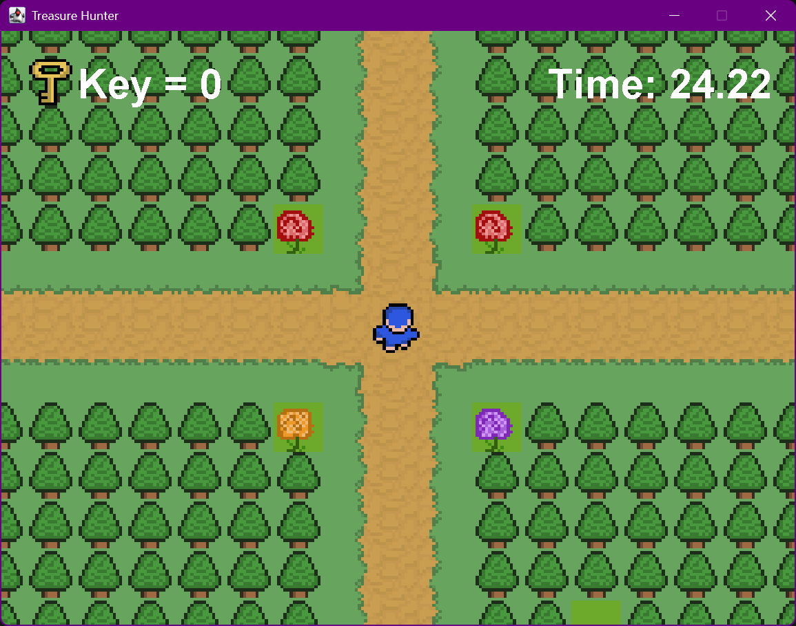
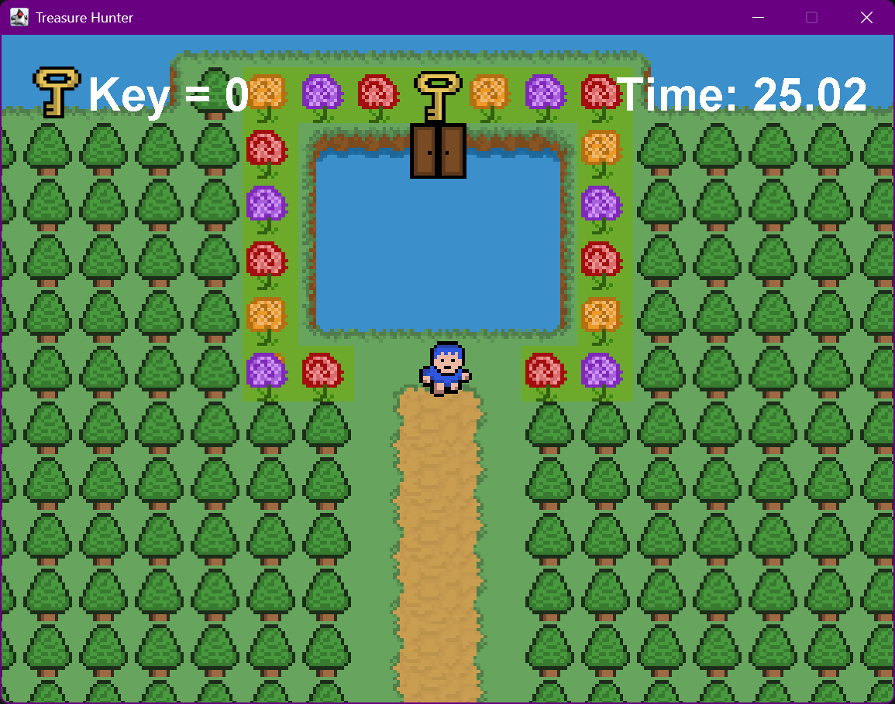
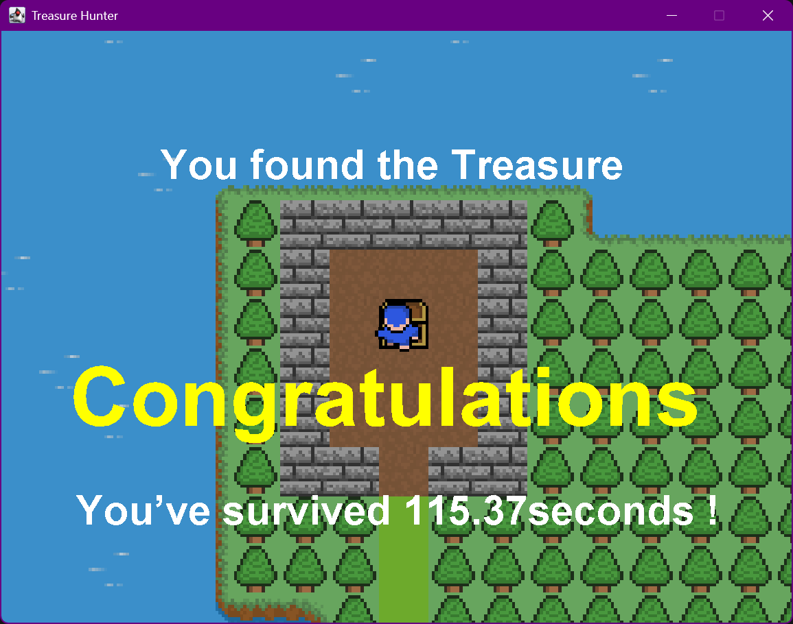

# Treasure Hunter 🎮

**Treasure Hunter** is a 2D adventure game built with Java, Swing, and AWT. It features a tile-based world, keyboard-controlled movement, interactive objects, collision detection, sprite animations, and audio.

Originally developed while following [RyiSnow's Java Game Development tutorial series](https://www.youtube.com/@RyiSnow), this project has been a hands-on learning experience in game development, object-oriented programming, and working with graphics and game assets.

## ✨ Features

- **Tile-Based World:** Explore a game world constructed from terrain tiles and map data.
- **Player Movement:** Navigate the environment using keyboard controls.
- **Collision Detection:** Handle interactions between the player and the game environment.
- **Interactive Objects:** Discover objects such as keys, doors, chests, and collectible items.
- **Sprite Animation:** Display character movement animations.
- **Audio Integration:** Include background music and sound effects.
- **Game UI:** Render the game world and interface using Java's graphics libraries.

## 📸 Screenshots

<p align="center">
  
</p>

<p align="center">
  
</p>

<p align="center">
  
</p>

## 🛠️ Tech Stack

- **Language:** Java
- **GUI and Rendering:** Java Swing and AWT
- **Graphics:** Java 2D, `BufferedImage`, and `ImageIO`
- **Game Architecture:** Custom game loop, tile management, and keyboard input handling
- **Version Control:** Git and GitHub
- **JDK:** Eclipse Temurin JDK 21

## 🚀 Getting Started

Follow these instructions to run the game locally on Windows.

### Prerequisites

- [Java Development Kit (JDK) 21](https://adoptium.net/) or a compatible JDK
- Git (optional, for cloning the repository)

### Installation

**1. Clone the repository**

```powershell
git clone https://github.com/AreebaAliSiddiqui/TreasureHunter.git
cd TreasureHunter
```

**2. Compile the source files**

Run this command from the project root in PowerShell:

```powershell
javac -d out (Get-ChildItem .\src -Recurse -Filter *.java | ForEach-Object { $_.FullName })
```

**3. Launch the game**

```powershell
java -cp "out;res" Main.Main
```

Keep the `res` directory alongside the generated `out` directory so the game can load its images, maps, and audio assets.

## 📁 Project Structure

```text
TreasureHunter/
├── src/
│   ├── Main/           # Game entry point, game loop, controls, and UI
│   ├── entity/         # Player and entity logic
│   ├── tile/           # Tile management and world maps
│   ├── Object/         # Interactive game objects
│   └── loadingScreen/  # Loading screen implementation
├── res/
│   ├── maps/           # World map data
│   ├── tiles/          # Terrain and environment graphics
│   └── ...             # Other game assets, including sprites and audio
├── LICENSE
└── README.md
```

## 🎓 Credits

This project was inspired by [RyiSnow's Java Game Development tutorial series](https://www.youtube.com/@RyiSnow). It was created for learning and personal practice, with additional modifications and experimentation.

Original tutorial materials and assets remain subject to their respective attribution and licensing requirements.

## 📄 License

See the [LICENSE](LICENSE) file for the license included in this repository. Third-party assets may have separate licensing terms.

## 👩‍💻 About the Developer

**Areeba Ali Siddiqui (Riva)**

Computer Science student interested in software engineering, Java development, artificial intelligence, and machine learning.

- [GitHub](https://github.com/AreebaAliSiddiqui)
- [LinkedIn](https://www.linkedin.com/)

Feedback and suggestions are welcome!git diff --check
git diff -- README.md